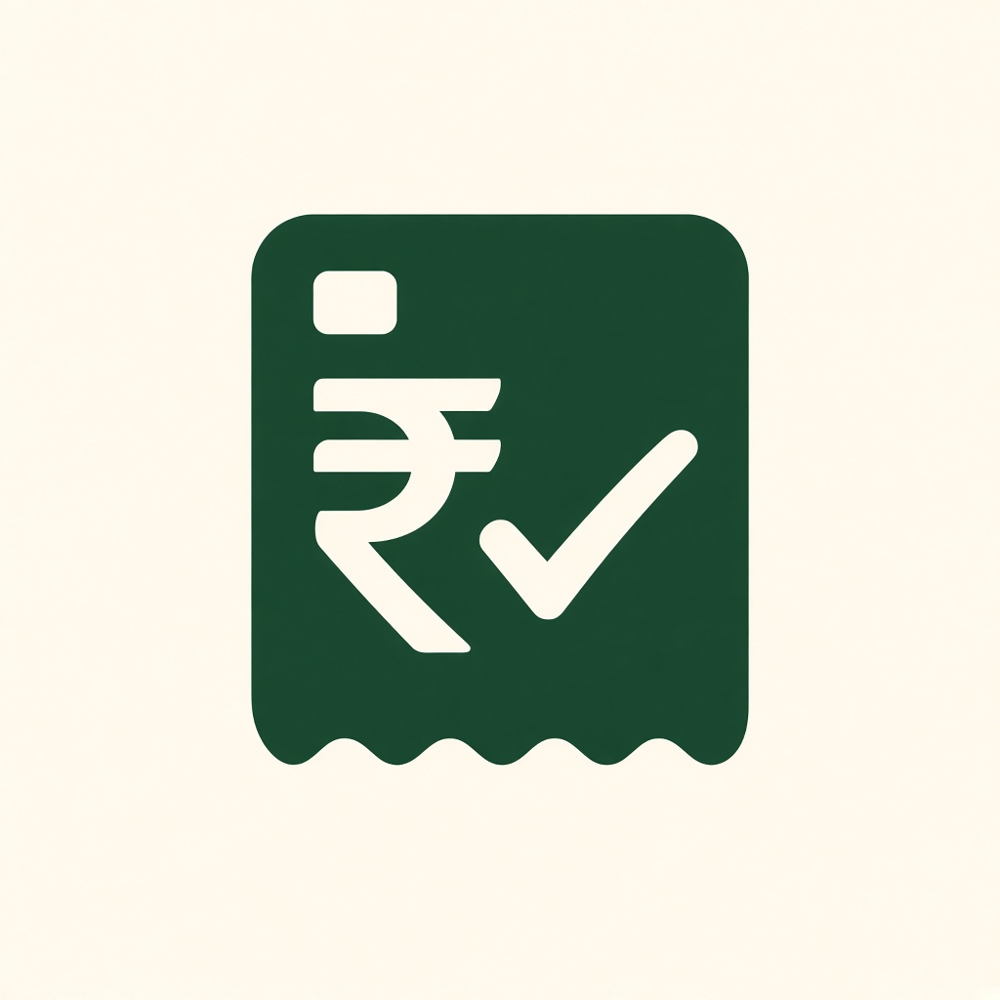

<p align="center">
  
</p>

<h1 align="center">BILLNOTE</h1>

<p align="center">
  Production-grade multi-tenant billing for Indian businesses.<br/>
  GST invoices, POS checkout, stock, and staff permissions — one account across web, phone, and desktop.
</p>

<p align="center">
  <a href="https://notebill.duckdns.org"><strong>Live app → https://notebill.duckdns.org</strong></a>
  ·
  <a href="docs/design">Design docs</a>
  ·
  <a href="https://github.com/akashconnect-sudo/billnote">GitHub</a>
</p>

<p align="center">
  
  
  
  
  
</p>

---

## Live

| | |
| --- | --- |
| **Web** | [https://notebill.duckdns.org](https://notebill.duckdns.org) |
| **Auth** | Email OTP on login & signup (password login still available) |
| **API health** | `https://notebill.duckdns.org/api/v1/health/ready` (via Caddy) |

---

## Features

- Multi-tenant businesses with role permissions
- Email OTP authenticator for login and create-account
- POS cart, GST helpers, charge / payments, printable receipts
- Products, barcode lookup, stock screens
- Redis-backed rate limits, sessions, and OTP codes
- DynamoDB single-table data plane (no Postgres)

---

## Stack

| Piece | Version / notes |
| --- | --- |
| Node | 24 LTS |
| pnpm | 9.15 |
| Next.js (web PWA) | 16 |
| NestJS (API) | 12 |
| Expo (mobile) | 54+ |
| AWS DynamoDB | single-table `billnote` |
| Redis | 7 |
| Caddy + DuckDNS | TLS reverse proxy on EC2 |

---

## Quick start (local)

```bash
pnpm install
cp .env.example .env
# Start Redis (and optional DynamoDB Local): docker compose up -d
pnpm --filter @billnote/shared build
pnpm --filter @billnote/ui build
pnpm --filter @billnote/api dev
pnpm --filter @billnote/web dev
```

- Web: http://localhost:3000  
- API: http://localhost:4000  
- OpenAPI (if `EXPOSE_DOCS=true`): http://localhost:4000/docs  

Without SMTP/SES configured, OTP emails log to the API console and the UI shows a **Dev OTP** in non-production.

### Email OTP (production)

Set one of:

```env
EMAIL_PROVIDER=ses
EMAIL_FROM=BILLNOTE <noreply@your-verified-domain>
# uses AWS_ACCESS_KEY_ID / AWS_SECRET_ACCESS_KEY / AWS_REGION
```

or

```env
EMAIL_PROVIDER=smtp
EMAIL_FROM=BILLNOTE <you@shop.com>
SMTP_HOST=email-smtp.ap-south-1.amazonaws.com
SMTP_PORT=587
SMTP_USER=...
SMTP_PASS=...
```

---

## Production (EC2)

Compose stack lives in [`deploy/`](deploy/): API, web, Redis, Caddy, optional DuckDNS updater.

```bash
cd /opt/billnote
git pull origin main
sudo docker compose --env-file .env -f deploy/docker-compose.prod.yml build
sudo docker compose --env-file .env -f deploy/docker-compose.prod.yml --profile duckdns up -d
```

Live URL: **https://notebill.duckdns.org**

---

## Scripts

| Command | What it does |
| --- | --- |
| `pnpm lint` | ESLint across packages |
| `pnpm typecheck` | TypeScript across packages |
| `pnpm test` | Vitest unit tests |
| `pnpm build` | Build packages and apps |

---

## Workspace layout

```text
apps/web        Next.js PWA
apps/api        NestJS API
apps/mobile     Expo Android/iOS
apps/desktop    Electron wrapper
packages/ui     Design system + tip components
packages/shared Money, tokens, help, terms
packages/db     DynamoDB client + repositories
packages/config tsconfig, eslint, env schema
deploy/         EC2 Docker + Caddy + DuckDNS
docs/design     System design
```

---

## Money rule

All money is integer **paise** (`bigint`). All quantities are integer **milli-units**. Use `@billnote/shared/money`. Never use JavaScript `number` for money.

---

## Phase status

| Phase | Status |
| --- | --- |
| 1 — Scaffold & design | Done |
| 2 — Auth, Redis, app shell, PWA | Done |
| 3 — Products & items UI | Done |
| 4 — POS, GST, receipts | Done |
| 5 — Dashboard, sidebar, bills list | In progress |
| UI R1 — Paper & Ink design system | Done |
| DynamoDB + Redis prod on DuckDNS | Live |
| Email OTP authenticator | Done |

Not yet: R2 app shell polish, parties/purchases deep APIs (Phase 6), offline/desktop printers (Phase 7).
