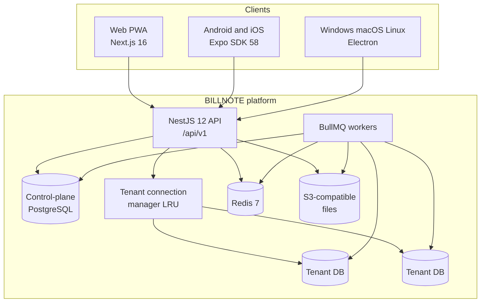
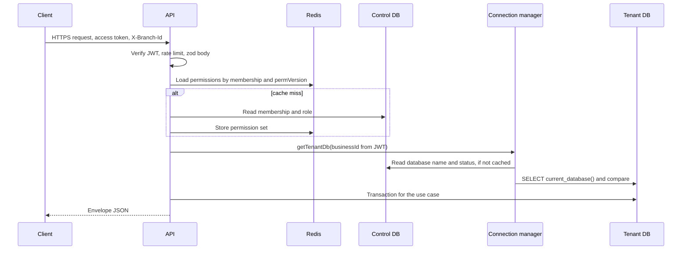

# Architecture

## System context



The browser, the phone app, and the desktop app are clients of one API. A business never reads another business's database. Workers share the API's domain code and run PDF generation, message sending, reports, provisioning, migrations, and backups.

## Runtime topology

| Piece | Choice | Role |
| --- | --- | --- |
| Web | Next.js 16 App Router, React, Tailwind 4, shadcn/ui | Installable PWA. Server components for public pages. The signed-in app calls the API; it does not open tenant databases. |
| Mobile | Expo SDK 58, React Native, TypeScript, EAS Build | One codebase for phones and tablets. Local SQLite for offline POS. |
| Desktop | Electron + electron-updater | Wraps the same product, adds file-system access, ESC/POS, and a tray icon. Offline SQLite as well. |
| API | NestJS 12, REST, OpenAPI | Auth, tenancy, all business operations. |
| Control DB | PostgreSQL 18 | Users, businesses, memberships, plans, provisioning state. |
| Tenant DB | PostgreSQL 18, one database per business | Every operational table. |
| Cache and queue | Redis 7 + BullMQ | Sessions permission cache, rate limits, jobs. |
| Files | S3-compatible bucket | Logos, product images, invoice PDFs, imports, backups. |
| ORM | Prisma 7, two schemas | `@billnote/db` exposes `getControlDb()` and `getTenantDb(businessId)`. |

Local development is `docker compose up` for Postgres and Redis, then `pnpm dev`. Production target, detailed in Phase 9, is AWS: ECS or EC2, RDS PostgreSQL, ElastiCache Redis, S3, in `ap-south-1`.

## Request path



Rules baked into the guard:

- `businessId` comes from the JWT claim `bid`. A body field named `businessId` or `tenantId` is ignored.
- `X-Branch-Id` is optional. The guard checks that the staff member is assigned to that branch. A missing header uses the staff member's default branch.
- Every use case receives a request context from `AsyncLocalStorage`: `requestId`, `userId`, `businessId`, `membershipId`, `staffId`, `roleKey`, `permissions`, `branchId`.

## Tenant connection manager

```text
maxClients        = 80
connectionsEach   = 2
idleEvictAfter    = 5 minutes
sweepInterval     = 30 seconds
```

Budget at the cap: 160 tenant connections, plus about 20 for the control plane, 20 for workers, and 20 for migrations and admin. The Postgres `max_connections` setting must leave headroom above that sum. The number 80 is a config value, not a constant buried in code.

`getTenantDb` does this:

1. Reject the call when the business status is anything other than `ready`.
2. Return the cached Prisma client on a hit, and confirm `current_database()` still equals the expected name.
3. On a miss, evict the least-recently-used client that is idle, disconnect it, and open a client whose URL contains only the cluster host and the database name.
4. The database password comes from the secret for that `cluster_key`. It is never stored on the business row.

A mismatch on `current_database()` closes the client, logs an error, and fails the request. It never runs the query "anyway".

Workers that migrate or back up a tenant open a short-lived connection and do not use the request cache.

## Processes

| Process | Owns |
| --- | --- |
| `api` | HTTP, auth, synchronous use cases |
| `worker` | BullMQ consumers: provision, migrate, pdf, message, report, backup, purge |
| `scheduler` | Enqueues repeatable jobs: backup nightly, permission-cache nothing, reminder scan, migration drain |

In local compose, `worker` and `scheduler` can be one Node process with two loops. In production they are separate services so a PDF pile-up cannot block provisioning.

## Jobs

| Queue | Payload | Idempotency |
| --- | --- | --- |
| `provision` | `businessId` | Status row. Re-running continues from the failed step. |
| `migrate` | `businessId`, `targetVersion` | `tenant_migration_state` lock |
| `pdf` | `businessId`, `documentId`, `templateId` | Output key includes a content hash |
| `message` | `businessId`, `outboxId` | Outbox row status |
| `report` | `businessId`, `reportKey`, `filters` | Stored file key |
| `backup` | `businessId`, `date` | Object key for that date |
| `purge` | `businessId` | Tombstone row |

Job payloads carry `businessId` because there is no JWT on a worker. The worker loads the database name from the control plane. It still asserts `current_database()`.

## File storage

Object keys:

```text
tenants/{businessId}/logos/{fileId}
tenants/{businessId}/products/{fileId}
tenants/{businessId}/docs/{documentId}/{fileId}.pdf
tenants/{businessId}/imports/{fileId}
backups/{businessId}/{yyyy-mm-dd}.dump
```

The API issues short-lived upload and download URLs. The bucket is private. Upload validation checks size, MIME, and an allow-list per purpose (image, pdf, csv, xlsx). Executables are rejected.

## Observability

- pino JSON logs. Redact `authorization`, `cookie`, `password`, `refreshToken`, `otp`, `totp`, bank account numbers. GSTIN is logged as the last four characters when a log line needs it.
- `requestId` on every log line and in the response envelope.
- Sentry on API, workers, web, and mobile. Source maps uploaded in CI. The tenant database name may be a tag. Row contents may not.
- `GET /health/live` returns 200 when the process is up.
- `GET /health/ready` checks control-plane Postgres and Redis.
- `GET /metrics` is Prometheus text, bound so only the internal network can call it.

## Shared package boundaries

| Package | May contain | May not contain |
| --- | --- | --- |
| `packages/shared` | Zod schemas, help catalog, tokens, breakpoints, money, GST pure functions, category presets, permission keys | React, Prisma, Nest |
| `packages/ui` | Web `<Tip>` and design-system components | API calls |
| `packages/config` | ESLint, tsconfig, env zod | Business rules |
| `packages/db` | Prisma schemas, SQL migrations, connection manager | HTTP |

The mobile app has its own thin tooltip component that reads the same `help/en.ts` catalog. The catalog has one source.

## Category presets

A preset is data in `packages/shared/categories`. The dashboard engine, the product form, and the seed step all read it. Adding a business type means adding a preset object: modules, widgets, extra fields, default units, default tax rates, quick-add items, and the owner and cashier layouts.

The full key list is in [04-barcode-permissions-ux.md](04-barcode-permissions-ux.md). The engine does not `switch` on category names.

## Pluggable providers

These interfaces ship with a stub or a mock. Real adapters land in the phase noted.

| Interface | First adapter | Later |
| --- | --- | --- |
| `EInvoiceProvider` | `StubEInvoiceProvider` returns a fake IRN in non-production and refuses in production | NIC / GSP adapter, Phase 8 or 9 |
| `EwayBillProvider` | Stub, same rule | Same phase as e-invoice |
| `ProductLookupProvider` | `OpenFoodFactsAdapter` plus an in-memory fixture for tests | More catalogues behind the same interface |
| `MessageProvider` | Log-only sender that writes the outbox | WhatsApp, SMS, email in Phase 8 |
| `PaymentGateway` | Razorpay for BILLNOTE's own subscriptions, Phase 9 | — |

Production must not confirm a real IRN through the stub. The stub checks `NODE_ENV` and the feature flag `EINVOICE_STUB`.

## Worked path: confirm a cash sale

One database transaction on the tenant DB:

1. Lock the draft document row.
2. Assign the series number if the client did not already hold a reserved number.
3. Recompute every line total with the shared GST functions. Reject the request when the client's totals differ, and return the server totals so the UI can refresh.
4. Insert stock movements and update `stock_balances` for stocked lines.
5. Insert the payment and the allocation.
6. Insert the journal and its lines.
7. Mark the document `paid` or `partially_paid`.
8. Append the outbox row for PDF and the optional message.
9. Commit.

A failure rolls back stock, journal, number, and payment together. The number increment uses `UPDATE invoice_series SET next_number = next_number + 1 WHERE id = $1 RETURNING next_number - 1` inside that transaction, or consumes a reserved block row the same way.

The PDF worker runs after commit. The sale is already safe if PDF generation fails; the user can retry the print.
