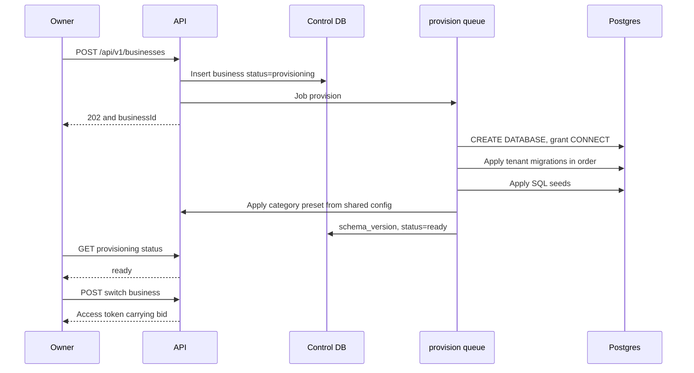
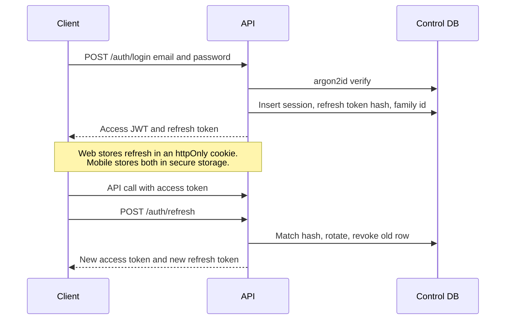
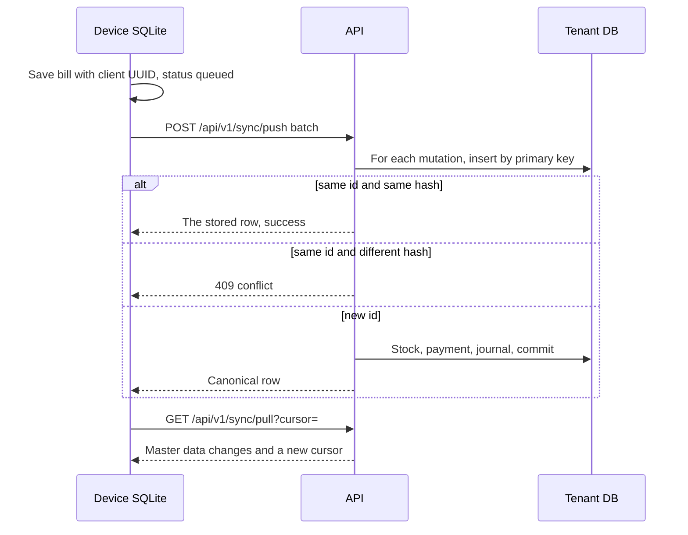

# Tenancy, auth, and sync

## Control plane and tenant plane

| Data | Where |
| --- | --- |
| Person, password, sessions, OTP, 2FA | Control plane |
| Which businesses a person can open | Control plane (`memberships`) |
| Plan and subscription | Control plane |
| Database name and migration progress | Control plane |
| Catalogue, bills, stock, ledgers, dashboards | That business's database |

A person can belong to many businesses. A business has one database. Branches, counters, and staff live inside that database.

## Provisioning



Steps are idempotent:

| Step | If it is run twice |
| --- | --- |
| Insert business | The client retries with the same idempotency key and receives the original business |
| `CREATE DATABASE` | Ignore "already exists" when the name matches this business |
| Migrations | `schema_migrations` skips applied versions after a checksum match |
| Seeds | Upsert on natural keys (`units.key`, `roles.key`, `accounts.code`) |
| Mark ready | Overwrites status to `ready` only when the version equals the target |

Failure sets `status = failed` and stores the error on `tenant_migration_state`. The owner sees "We could not finish setting up your shop. We will retry." The worker retries with backoff up to 5 times, then leaves it failed for an operator. The owner can hit "Try again", which re-enqueues the job.

`CREATE DATABASE` cannot run inside a transaction. The control-plane row is committed first, then the database is created.

Database name: `bn_` plus the business uuid in Crockford base32, lowercase, well under the 63-character identifier limit. The role `billnote_app` receives `CONNECT` and table rights on that database only. `PUBLIC` connect is revoked.

## Migration runner

Every tenant database has:

```text
schema_migrations(version, name, checksum, applied_at)
```

The control plane has `tenant_migration_state` (one row per business) and `tenant_migration_runs` (one row per version attempt).

Target version is the highest file in `packages/db/tenant-migrations`, named `V0001__init.sql`, `V0002__seed_reference.sql`, and so on. Checksum is SHA-256 of the file bytes. A checksum change on an already-applied version is a hard failure. Authors add a new file.

Worker loop:

1. `SELECT ... FROM tenant_migration_state WHERE current_version < target AND (status <> 'running' OR lock_expires_at < now()) ORDER BY current_version FOR UPDATE SKIP LOCKED LIMIT 1`.
2. Set `running`, `locked_by`, and a 10-minute lock.
3. Open the tenant database. Apply the next version inside a transaction. Insert `schema_migrations`. Commit.
4. Set `current_version` to that version on the control plane. A crash here is safe: the next pass sees the tenant already has the version and advances the control row.
5. Repeat until `current_version = target`, then set `idle`.

`CREATE INDEX CONCURRENTLY` cannot run in a transaction. A migration file may start with `-- billnote: no-transaction`. The runner applies it outside a transaction and records progress only after success. Those files must be written so a retry is safe.

Deploy policy: migrations are backward compatible with the API version still running. A column drop ships in a later release, after every tenant is migrated and no running code reads the column. Batches are 25 tenants at a time so a bad migration stops before it reaches every business.

## Auth



| Token | Lifetime | Storage |
| --- | --- | --- |
| Access JWT | 15 minutes | Web: memory only. Mobile and desktop: secure storage. |
| Refresh | 30 days, rotated on every use | Web: cookie `__Host-bn_refresh`, `HttpOnly`, `Secure`, `SameSite=Lax`, path `/api/v1/auth`. Mobile: secure storage. |

JWT claims: `sub` (user id), `bid` (business id, omitted before a business is selected), `mid` (membership id), `role`, `pv` (permission version integer), `sid` (session id), `iat`, `exp`.

Permissions are not packed into the JWT. The API loads them from Redis at key `perm:{membershipId}:{pv}`. Changing a role bumps `pv` on the membership, which makes the old cache key unused.

Refresh reuse: if a refresh token that was already rotated is presented again, the API revokes every session in that `family_id` and requires login. That cuts a stolen rotated token off the account.

CSRF: cookie-authenticated requests must send header `X-Billnote-Request: 1`. Browsers will not add that header on a cross-site form post. CORS allows only the configured web origins.

Passwords: argon2id, 19 MiB memory, 2 iterations, parallelism 1. The hash is stored. The password is not logged.

OTP login: 6 digits, 5-minute expiry, hash stored, 5 attempts, then the challenge is dead. A destination can request 3 OTPs in 15 minutes. The SMS sender is the message provider (log-only until Phase 8 wires a real SMS vendor). The API and the rate limits exist in Phase 2.

2FA: optional TOTP. The secret is encrypted with AES-256-GCM before it is stored. Login with a password returns `mfa_required` and a short-lived ticket when TOTP is on.

Sessions: the owner can list devices and revoke one or all. `logout` revokes the current family. Disabled users fail the next refresh.

Signup accepts email or Indian mobile (`+91` and 10 digits starting 6–9). At least one of email or phone is required. Verification is an OTP or a link before the business can send invoices to customers from that channel. The owner can still explore the dashboard.

## RBAC

System roles, seeded in every tenant database:

| Role | Intent |
| --- | --- |
| `owner` | Every permission, including billing of the BILLNOTE subscription and delete |
| `manager` | Day-to-day setup, staff, reports, void. No subscription cancel, no hard delete of the business |
| `cashier` | POS: create bills, take payment, look up items and customers, create a customer |
| `accountant` | Ledgers, GST exports, expenses, period lock. Read products. No POS settings |
| `staff` | Attendance and the tasks a module grants (for example a job card assigned to them) |

Custom roles: the owner clones a role and toggles permission keys. Keys are `module.action` strings from `packages/shared/permissions.ts`. The database stores the keys. The API guard is `@RequirePermission('invoice.create')`. Unknown keys in the database are ignored and logged, so an old database does not crash a new API.

Starter permission keys:

```text
invoice.create invoice.read invoice.update invoice.void invoice.share
quote.create quote.convert
payment.create payment.read
product.create product.read product.update product.delete product.import
stock.adjust stock.transfer stock.count
party.create party.read party.update party.delete
purchase.create purchase.read
expense.create expense.read
report.view report.export
accounting.view accounting.lock
settings.manage settings.tax
staff.manage role.manage
dashboard.customize
template.manage
sync.replay
```

The cashier set is: `invoice.create`, `invoice.read`, `invoice.share`, `payment.create`, `payment.read`, `product.read`, `party.read`, `party.create`.

UI gate: the client hides a control when the permission is missing, and the API still checks. Hiding is for calm screens, not for safety.

Business switcher: `GET /api/v1/me/businesses` lists memberships. `POST /api/v1/me/businesses/:id/switch` checks the membership and returns an access token with the new `bid`. The web app then loads that tenant's shell. The mobile app keeps a separate SQLite file per business id so two shops cannot mix in one local database.

## Sync

Offline POS on mobile and desktop writes to SQLite first and pushes to the API when the network is up.



| Kind of data | Conflict rule |
| --- | --- |
| Products, parties, settings, price lists, templates | Server wins. The device replaces its row and shows "This was changed on another device. Your edit was not saved." when the push version is stale. |
| Invoices, payments, stock movements, scan events | Append-only. The client UUID is the primary key. A retry of the same payload returns the original result. |
| Confirmed invoice number | Never rewritten. Numbers come from a block reserved for that device. |

Cursors are opaque strings encoding `(updatedAt, id)`. Pull is stable under inserts because the sort is `(updated_at, id)` and the comparison is "greater than the cursor".

Local tables mirror the sync subset: products, variants, barcodes, tax rates, units, parties, price list items, series blocks, held and queued documents, payments, a stock snapshot, and the outbox.

Sync states shown in the header chip:

| Chip | Meaning |
| --- | --- |
| All saved | Outbox empty and last pull succeeded |
| Syncing… | A push or pull is in flight |
| Offline: will sync later | No network, outbox may contain bills |
| Needs a look | A 409 or a validation error needs the person |

Invoice number blocks:

- Table `number_blocks` rows are disjoint ranges per series.
- A device asks for a block when it is online and fewer than 20 numbers remain.
- Block size is 100.
- Confirming a bill offline consumes `next_no` inside the local copy of the block.
- When the block is empty and the device is offline, the POS can hold the bill and cannot confirm a tax invoice. The screen says "Connect once to get more bill numbers."

Stock on the device is a cache. The server's `stock_balances` wins on the next pull. The POS may show "Stock will update when you are back online" after an offline sale.

## Audit and privacy on the control plane

Login success and failure go to `login_events`. Session revoke goes there too.

Account-level consent (terms and privacy policy) is a `consent_records` row with the policy version and timestamp. Tenant-level permission consent (camera, location, and the rest) lives in the tenant database, because it is about that shop's devices. See the permissions design.

Export of a person across businesses is a control-plane job that asks each tenant database the person belongs to. Delete of a business is described in the security document.
