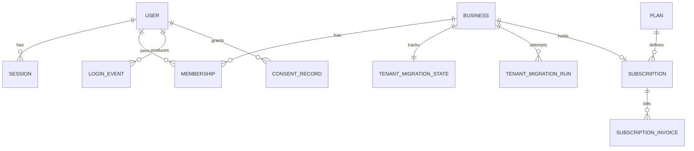
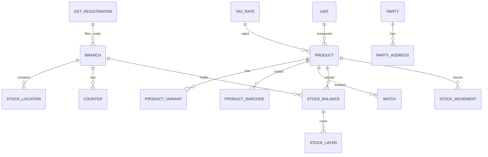
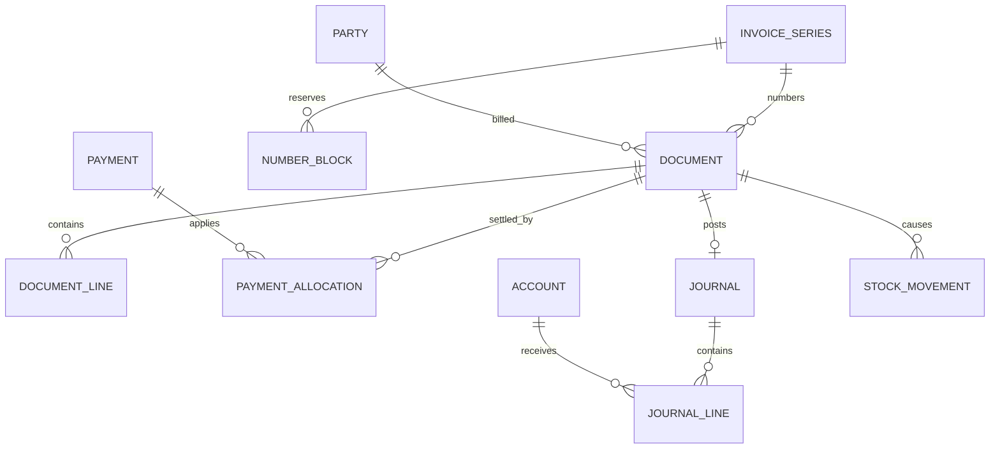

# Data model

The SQL files are the schema contract:

- [schema/control.sql](schema/control.sql) — one database for the whole platform
- [schema/tenant.sql](schema/tenant.sql) — the database created for each business

Prisma 7 models in Phase 2 and Phase 3 mirror these tables. Where Prisma cannot express a partial unique index, the SQL migration is the authority and a CI check fails if `prisma migrate diff` drifts from the SQL.

## ER — control plane



## ER — tenant, catalogue and stock



## ER — tenant, documents and ledger



Category tables (tables, KOTs, appointments, job cards, memberships, fees, rooms, trips, visits, recipes) reference `parties`, `staff`, and `documents`. They are drawn in the SQL file and omitted here so the money diagram stays readable.

## What lives where

Tenant tables do not contain `business_id`. Isolation is the database. Syncable rows use UUID primary keys generated on the device (UUID v7 from the app). Server-only rows may use `gen_random_uuid()`.

Immutable after insert: `stock_movements`, `journals`, `journal_lines`, `audit_logs`, `scan_events`, `loyalty_entries`, `payments`, `payment_allocations`. Fixes are new rows (a reversal journal, a refund payment, a stock adjustment).

Mutable until confirm: document drafts and held bills. After confirm, totals, party, and number are frozen by trigger. `status` and `amount_paid_paise` still move as payments arrive.

## Money and quantities

| Measure | Storage | Example |
| --- | --- | --- |
| Money | `bigint` paise | ₹118.00 = `11800` |
| Quantity | `bigint` milli-units | 1.5 kg = `1500` |
| Tax rate | `integer` basis points | 18% = `1800` |
| Unit cost inside FIFO layers | `bigint` micro-paise per whole unit | ₹10.505 per unit = `1050500` |

A micro-paise is 1/1000 of a paise. Layer cost of a movement in paise is:

```text
divRoundHalfAway(qty_milli * unit_cost_micro_paise, 1_000_000)
```

Weighted average does not store a unit cost. It stores `qty_milli` and `value_paise` on `stock_balances`.

```text
receipt:  value = value + receipt_value_paise
          qty   = qty + receipt_qty_milli

issue:    issue_value = divRoundHalfAway(value * issue_qty, qty)
          value = value - issue_value
          qty   = qty - issue_qty

qty hits 0: value is posted to the inventory-adjustment account and set to 0
```

`packages/shared/money` is the only place that does this arithmetic. ESLint forbids `number` types on any symbol whose name ends in `Paise` or `Milli`.

Display uses `en-IN` grouping: ₹1,23,456.78. The rupee symbol and the word "Rs" both appear in Simple Mode; the ledger screens in Advanced Mode use the same formatted amounts.

## GST

Place of supply:

- Compare the branch GST registration state with the party's state.
- Same state: CGST + SGST. Different state: IGST.
- A walk-in bill with no party uses the branch state, so it is intra-state.
- The document stores `supply_type`, the state code, and every tax component that was charged.

Rates live in `tax_rates` (0, 500, 1200, 1800, 2800, plus an exempt row). Cess is `cess_bps` on the rate and on the line. HSN/SAC is a text column, 4 to 8 digits, and may be empty. The product form says so in its tooltip.

Composition scheme: the business profile flag forces tax components to 0 and the document type `bill_of_supply`.

Reverse charge: line tax is still computed and stored for the return. `grand_total_paise` does not include that tax. The journal posts input GST and an RCM liability instead of charging the customer. The full journal template is implemented in Phase 6; the columns exist now.

### Rounding

Half away from zero, integer paise:

```text
divRoundHalfAway(n, d):
  sign = sign of n
  n, d = absolute values
  q = n / d
  r = n % d
  if r * 2 >= d then q = q + 1
  return sign * q
```

Exclusive line:

```text
line_after_discount = taxable input
gst  = divRoundHalfAway(taxable * gst_bps, 10000)
cess = divRoundHalfAway(taxable * cess_bps, 10000)
```

Inclusive line (the typed price already includes GST and cess):

```text
gross = the typed line amount after discount
taxable = divRoundHalfAway(gross * 10000, 10000 + gst_bps + cess_bps)
tax_pool = gross - taxable
gst  = divRoundHalfAway(tax_pool * gst_bps, gst_bps + cess_bps)   when cess is present
cess = tax_pool - gst
```

The inclusive split keeps `taxable + gst + cess = gross`. When `gst_bps + cess_bps` is 0, both tax components are 0 and the taxable value is the gross. The split does not divide by zero.

Intra-state split of the GST paise:

```text
cgst = divRoundHalfAway(gst, 2)     which, for a positive amount, is ceil(gst / 2)
sgst = gst - cgst
igst = 0
```

Inter-state: `igst = gst`, `cgst = 0`, `sgst = 0`.

A bill discount is allocated across lines by each line's pre-discount taxable share. Leftover paise go to the largest line. Tax is computed after that allocation.

Round-off to the nearest rupee, when the business setting is `nearest_rupee`:

```text
target    = divRoundHalfAway(total, 100) * 100
round_off = target - total
grand     = target
```

`round_off_paise` may be negative. The journal posts it to the Round off account.

Credit notes use the same functions with negative quantities or negative amounts. Tests must cover a negative taxable value.

### Worked examples

These become unit tests in Phase 4. Amounts are paise.

**Inclusive ₹118, 18%, intra-state, no cess.** Gross `11800`. Taxable `10000`. GST `1800`. CGST `900`. SGST `900`.

**Exclusive ₹100, 18%, inter-state.** Taxable `10000`. IGST `1800`. Grand `11800`.

**Exclusive ₹100, 10% line discount, 18%, intra-state.** Discount `1000`. Taxable `9000`. GST `1620`. CGST `810`. SGST `810`. Grand `10620`.

**Odd paise.** Taxable `1005`, 18%, intra-state. GST = `divRoundHalfAway(1005 * 1800, 10000)` = `divRoundHalfAway(1809000, 10000)` = `181`. CGST `91`. SGST `90`.

### Cash sale journal

Inclusive ₹118, cost ₹60, paid in cash, intra-state:

| Account | Debit | Credit |
| --- | --- | --- |
| Cash | 11800 | |
| Sales | | 10000 |
| Output CGST | | 900 |
| Output SGST | | 900 |
| COGS | 6000 | |
| Inventory | | 6000 |

### Credit sale and later receipt

Exclusive ₹100 + IGST ₹18, unpaid:

| Account | Debit | Credit |
| --- | --- | --- |
| Accounts receivable (party subledger) | 11800 | |
| Sales | | 10000 |
| Output IGST | | 1800 |

Receipt of ₹118 by UPI:

| Account | Debit | Credit |
| --- | --- | --- |
| Bank or UPI clearing | 11800 | |
| Accounts receivable | | 11800 |

Each party gets a subledger account under Accounts receivable or Accounts payable, created when the party is created. The trial balance can show the control account; the party screen shows that party's lines.

System account codes are seeded and `is_system = true`. The owner can add expense accounts. System accounts cannot be deleted.

| Code | Name | Type |
| --- | --- | --- |
| 1000 | Cash | asset |
| 1010 | Bank | asset |
| 1100 | Accounts receivable | asset |
| 1200 | Inventory | asset |
| 1300 | Input CGST | asset |
| 1310 | Input SGST | asset |
| 1320 | Input IGST | asset |
| 1330 | Input cess | asset |
| 2000 | Accounts payable | liability |
| 2100 | Output CGST | liability |
| 2110 | Output SGST | liability |
| 2120 | Output IGST | liability |
| 2130 | Output cess | liability |
| 2140 | RCM liability | liability |
| 2200 | Round off | income |
| 3000 | Owner's capital | equity |
| 4000 | Sales | income |
| 4100 | Sales returns | income |
| 5000 | COGS | expense |
| 5100 | Purchases | expense |
| 5200 | Expenses | expense |
| 5300 | Inventory adjustment | expense |

`2200` is seeded as income and may be debited when round-off goes the other way. The report nets it.

A period with `accounting_periods.locked_at` set rejects new journals in that date range and rejects void of documents in that range. The owner posts a reversal in an open period instead.

## Invoice numbers

A series is unique on `(gst_registration_id, branch_id, doc_type, financial_year_id)`. `branch_id` null means the series covers every branch that shares that GSTIN. `display_number` is unique across the tenant database among live rows.

Default template: `{prefix}/{fy}/{seq:6}` → `INV/2526/000123`.

| Doc type | Prefix |
| --- | --- |
| tax_invoice | INV |
| bill_of_supply | BOS |
| quotation | QT |
| proforma | PF |
| sales_order | SO |
| delivery_challan | DC |
| credit_note | CN |
| debit_note | DN |
| sales_return | SR |
| purchase_order | PO |
| purchase_bill | PB |
| purchase_return | PR |

Financial year default is 1 April to 31 March, overridable with `business_profile.fy_start_month`.

## Indexes that reports need

Defined in the SQL file. The ones that protect correctness:

| Index | Why |
| --- | --- |
| Unique `product_barcodes.barcode` where `deleted_at` is null | One live barcode per business |
| Unique `documents (series_id, number)` where number is not null and `deleted_at` is null | One bill number per series |
| Unique `documents.display_number` on live numbered rows | A person never sees two identical bill numbers |
| Unique `stock_balances (product, variant, branch, location, batch)` with `NULLS NOT DISTINCT` | One quantity row |
| `(issued_on, status)` on documents | Day book and GST period |
| `(party_id, issued_on)` on documents | Outstanding and statements |
| `(product_id, branch_id, occurred_at)` on stock movements | Item history |
| `(account_id, posted_on)` on journal lines | Ledger |
| GIN trigram on product name, party name, display number | POS search |

## Seeds the provisioner applies

SQL seed (`V0002`), idempotent:

- Units: piece, kg, g, litre, ml, metre, box, dozen, pair
- Tax rates: 0%, 5%, 12%, 18%, 28%, exempt
- System roles and the permission keys listed in the tenancy doc
- Chart of accounts above
- One default GST registration row copied from signup, one branch "Main", one location "Shop floor", one counter "Counter 1"
- One invoice series per doc type for the open financial year
- Print templates: the 10 starter layouts (Phase 4 fills their JSON; Phase 3 inserts named rows)
- Walk-in behaviour uses a null `party_id`, so there is no fake customer row

TypeScript seed after SQL, from the category preset:

- Dashboard layout for owner and for cashier
- Quick-add items
- Extra custom field definitions
- Suggested categories (for example "Vegetables" for a produce shop)

## Retention

Soft-deleted products, parties, and drafts keep `deleted_at`. The owner can undo for 30 days. A daily job then hard-deletes those rows if no confirmed document references them. Confirmed documents are not hard-deleted on that timer. Deleting a whole business is a separate owner action described in the security doc.

## GSTIN check

Format, also a SQL check:

```text
^[0-9]{2}[A-Z]{5}[0-9]{4}[A-Z][1-9A-Z]Z[0-9A-Z]$
```

The 15th character is a mod-36 check digit over the first 14, weighted from the right with factors 2,1,2,1… The alphabet is `0-9A-Z`. Phase 2 ships this as a pure function with test vectors generated from the algorithm. A portal lookup is a later provider, not a blocker for saving a customer.
