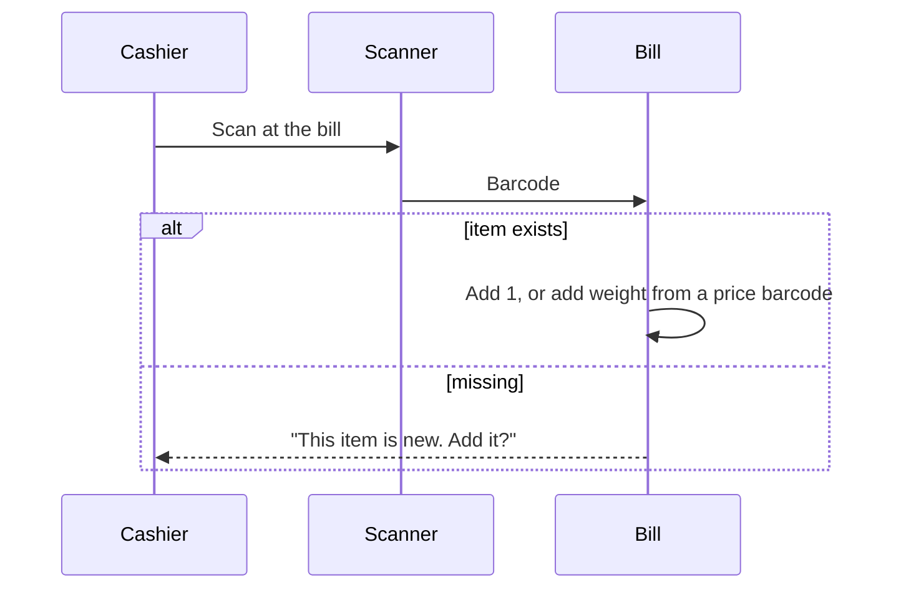
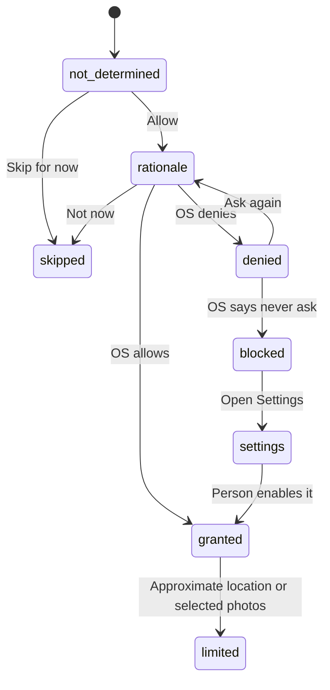

# Barcode, permissions, and the interface

## Barcode flows

Three flows share one scanner service. The service emits a code string. The screen decides what to do with it.

Symbologies: EAN-13, EAN-8, UPC-A, UPC-E, Code 128, Code 39, QR, Data Matrix.

```mermaid
sequenceDiagram
  participant U as Person
  participant S as Scanner
  participant DB as Tenant DB
  participant OFF as Product lookup

  U->>S: Scan to add an item
  S->>DB: Find barcode
  alt found
    DB-->>U: Open the item, ready to save
  else missing
    S->>OFF: Lookup barcode
    OFF-->>U: Prefill name, brand, image
    U->>DB: Confirm and save with this barcode
  end
```



Stock-take uses the same scanner, writes `stock_count_lines`, and posts the difference as stock movements when the count is confirmed.

Scanner behaviour:

| Rule | Value |
| --- | --- |
| Continuous mode | On by default on the bill screen |
| Duplicate debounce | Ignore the same code for 800 ms |
| Feedback | Short beep and a haptic tap |
| Torch | Toggle on the camera screen |
| Camera denied | Manual type-in, and USB or Bluetooth wedge still works |
| Web camera | `BarcodeDetector` when the browser has it, otherwise zxing WASM |
| USB or Bluetooth wedge | A global listener treats a burst faster than 30 ms per key, ending in Enter, as a scan. It does not steal slow typing. |

In-store weight barcodes (prefixes 20–29) are parsed with a per-business pattern: prefix length, item-code length, and whether the payload is weight or price. The default pattern is documented in the preset for fruits and vegetables and can be edited in settings.

Every scan writes `scan_events`.

External lookup goes server-side to Open Food Facts (`/api/v2/product/{barcode}`) through `ProductLookupProvider`. Results are cached in the control-plane `barcode_lookup_cache` for 30 days. The person always confirms before a product row is created. A miss opens an empty form with the barcode already filled.

Label printing: a layout editor for 1-up, 2-up, and 3-up sheets and for thermal label rolls. Phase 3 ships the data and a basic layout. The full editor arrives with the template designer in Phase 8. The desktop app prints ESC/POS and TSPL-style labels; until then the fallback is a PDF.

## Permissions

Asked after login, inside onboarding, one at a time. Skip never blocks the app. The OS dialog appears only after a rationale screen.



| Permission | Why we ask, in plain words | If they say no |
| --- | --- | --- |
| Camera | To scan barcodes and take photos of items | Type the barcode, or use a USB scanner |
| Location, while in use | To fill your state for GST, and for attendance only if you turn that on | Pick the state yourself |
| Notifications | To tell you about payments, low stock, and sync | The bell inside the app still works |
| Photos and files | To pick item photos and Excel files, and to share PDFs | Take a photo with the camera, or skip images |
| Bluetooth | To print bills and labels on a wireless printer | Share a PDF or use the system print dialog |
| Contacts | To copy customer names from your phone | Add customers by hand |

Microphone is not in the manifest and is not requested.

Location in the background exists only after a second consent screen, and only when the owner turns on attendance or visit tracking (`business_profile.location_tracking_enabled`). The default is off.

Each grant, denial, and skip writes a tenant `consent_records` row with the time and the policy version. The Permissions & Privacy screen lists the current OS state, a control to open settings, and a button that deletes `location_events`.

`usePermission(type)` lives in `packages/shared` as a state machine plus a platform adapter:

| Platform | Adapter |
| --- | --- |
| Web | Permissions API, `getUserMedia`, Geolocation, Notification, Web Bluetooth where the browser has it. HTTPS only. |
| Android | Declares camera, approximate/fine location while in use, `POST_NOTIFICATIONS`, `BLUETOOTH_SCAN`, `BLUETOOTH_CONNECT`. Uses the system photo picker. No broad storage permission. |
| iOS | Usage strings in plain English for camera, location when in use, Bluetooth, photo library. |
| Desktop | Electron guidance when the OS has blocked the device. |

The web and mobile adapters are the only callers of the OS APIs. Screens call `usePermission`.

## Layout by screen size

Breakpoints, shared by web and mobile:

| Name | Width |
| --- | --- |
| xs | under 360 |
| sm | 360–599, phone |
| md | 600–1023, tablet |
| lg | 1024–1439, laptop |
| xl | 1440 and up |

`useBreakpoint()` and container queries both read these tokens. Touch targets are at least 48 by 48. Body text is at least 16 px on phones. Contrast meets WCAG AA. Hover styles apply only under `@media (hover: hover) and (pointer: fine)`. Keyboard focus draws a 2 px ring. `prefers-reduced-motion` turns off chart and tooltip animation.

Safe areas: `env(safe-area-inset-*)` on the web, and `react-native-safe-area-context` on mobile, including the Android gesture bar.

Navigation:

| Size | Chrome |
| --- | --- |
| Phone | Top bar with the shop name and the sync chip. Bottom tabs: Home, Bill, Items, More. The More tab opens a drawer. |
| Tablet | Navigation rail with icon and label. Lists open a detail pane beside them. |
| Laptop and desktop | Persistent sidebar, 240 px, with words. Optional right-hand inspector. |

A modal is a full-screen sheet on phones and a centered dialog from tablet upward. Forms are one column on phones and two columns from tablet up, with the primary button sticky. The focused field scrolls above the keyboard.

| Screen | Phone | Tablet | Laptop and desktop |
| --- | --- | --- | --- |
| Login | Full-width card | Centered 480 px card | Centered 480 px card |
| Onboarding | One step per screen | Same, wider | Same, centered |
| Dashboard | Cards in one column. Quick actions in two columns | Two card columns | Four cards on the first row, chart beside the list |
| POS | Search, then items, cart in a bottom sheet, total on a floating bar | Item grid and cart side by side | Grid, cart, and a customer column. Keyboard shortcuts |
| Items | Cards | List and detail | Table and inspector |
| Item form | One column | Two columns, sticky Save | Two columns, sticky Save |
| Customers | Cards | Split view | Table |
| Bill detail | Stacked sections | Stacked, wider | Form and preview side by side |
| Reports | Cards, or a sideways scroll with the first column pinned. Filters in a sheet | Table | Table, sticky header, filters on top |
| Settings | List that pushes a page | List and pane | List and pane |
| Template designer | Simple field list | Canvas | Canvas and a properties column |
| Scanner | Full-screen camera | Full-screen camera | Dialog plus a manual box |

Orientation changes keep the cart, the form draft, and the scroll position in memory. Lists on mobile use a virtualized list. POS add-to-cart is a local state update, targeted under 100 ms, and does not wait for the network.

Playwright viewports once screens exist: 360×640, 390×844, 768×1024, 1024×768, 1366×768, 1920×1080, portrait and landscape where the device rotates. A screen is done when those pass.

## Simple Mode and Advanced Mode

Simple Mode is the default. A setting switches the account, and each staff member can override it in `staff_preferences`. The component is `<Term k="receivable" />`. It reads the mode and renders one of the strings below. Tooltips use the Simple sentence even in Advanced Mode, so the plain explanation is always one hover away.

| Key | Simple | Advanced |
| --- | --- | --- |
| todaySales | Today's sales | Sales today |
| moneyIn | Money received | Receipts |
| receivable | Money you will get | Accounts receivable |
| payable | Money you will pay | Accounts payable |
| lowStock | Items almost finished | Below reorder level |
| profit | Profit | Gross profit |
| items | Items | SKUs |
| customers | Customers | Sundry debtors |
| suppliers | Suppliers | Sundry creditors |
| bill | Bill | Tax invoice |
| quote | Quote | Quotation |
| udhaar | Udhaar (pay later) | Credit sale |
| gst | GST | CGST, SGST, and IGST |
| hsn | Tax code (HSN) | HSN / SAC |
| stock | Stock | Inventory |
| cashInHand | Cash in the drawer | Cash book |
| bank | Bank | Bank book |
| daybook | Today's cash and bills | Day book |
| profitReport | Profit report | Profit and loss |
| balanceSheet | What you own and what you owe | Balance sheet |
| trialBalance | Check of the accounts | Trial balance |
| staffSales | Sales by staff | Staff-wise sales |

Advanced Mode reveals journal entries, ledger screens, and period lock. Simple Mode leaves those routes off the home screen. The API still enforces permissions.

Hindi uses the same keys in `help/hi.ts` and `terms/hi.ts`. English ships complete. Hindi copy is written with each screen and reviewed by a person before that screen is called done. The language switch sits on the first screen.

## Tooltips

One catalog, `packages/shared/help/en.ts`:

```ts
export const helpEn = {
  "dashboard.todaySales": "Total money you earned from bills made today.",
  "term.receivable": "Money your customers still need to pay you.",
  "dashboard.lowStock": "Items that are almost finished. Order them soon.",
  "field.hsn": "A tax code for your product. Your CA can tell you the right one. You can leave it empty if you are unsure.",
  "pos.hold": "Save this bill for later and start a new one.",
  "pos.scan": "Scan a product barcode with your camera to add it to the bill.",
} as const

export type HelpId = keyof typeof helpEn
```

Web `<Tip id="pos.scan">` and the React Native tooltip both look up the id. Missing keys are a TypeScript error because props take `HelpId`.

| Control | Contract |
| --- | --- |
| Icon button | Requires `helpId` and a `label`. The label is visible from the `lg` breakpoint up. `aria-label` is always set. |
| Dashboard card and chart | Requires `helpId` |
| Table column header | Requires `helpId` |
| Form field | Label plus an info button with `helpId` |
| Status badge | Requires `helpId` (Paid, Partially paid, Overdue, and the rest) |
| Settings switch and permission row | Requires `helpId` |

Behaviour: show after 300 ms of hover, also on keyboard focus, hide on leave, scroll, or Escape. `role="tooltip"` and `aria-describedby`. The bubble flips to stay on screen. On a touch screen, a long-press shows the tip, and the info button opens a small popover with an optional "Learn more" link. Help mode, from the `?` button in the header, lets the person tap a control to read the tip without firing the action.

A Playwright check fails when an element marked `data-icon-button` or `data-widget` has no `data-help-id`. A script lists catalog ids that no screen uses, so dead copy gets removed. It does not fail the build on unused ids.

Writing rule: about 20 words, everyday English, what it is and what happens when you tap it.

## Dashboard

Owner, Simple Mode, top of home, at most six cards:

| Card | Opens |
| --- | --- |
| Today's sales | Today's bills |
| Money received | Today's payments |
| Money you will get | Customers with a balance |
| Money you will pay | Suppliers with a balance |
| Items almost finished | Low-stock list |
| Profit | Today's profit breakdown |

Each card has an icon, a large amount, one sentence, and a colour: green when healthy, amber when it needs a look, red when it is urgent (for example overdue money, or an item at zero). Under the cards: New bill, Scan and sell, Add item, Add customer, Receive payment, Add expense.

Charts have plain titles ("Sales in the last 7 days"), a one-line summary ("You sold 12% more than last week"), and an empty state when there are no bills yet.

Cashier home is the POS, with today's sales as a single small total. The cashier does not see profit or payables.

The custom category starts from an empty layout. The owner adds widgets, renames them, reorders, resizes, and hides them. Phones use an up/down reorder list. Tablets and desktops use drag and resize with pointer events, so a finger and a mouse both work. The layout JSON is `dashboard_layouts.layout`. Widgets reflow to 1 column on phones, 2 on tablets, and 3 or 4 on desktops, using the spans stored in the layout.

## Category presets

Each preset is a config object: `key`, group, labels, modules, widgets, extra product fields, extra invoice fields, default units, default tax rates, quick-add names, and owner plus cashier layouts. Adding a type is a new object, not a new dashboard implementation.

| Key | Group | Modules and extra fields beyond a plain bill |
| --- | --- | --- |
| grocery | retail | Weighable items, quick-add staples |
| general_store | retail | Quick-add |
| supermarket | retail | Multi-counter, variants |
| produce | retail | Weighing, weight barcodes |
| dairy | retail | Batch, expiry |
| meat_fish | retail | Weighing |
| bakery | retail | Batch, expiry |
| stationery | retail | — |
| hardware | retail | — |
| electrical | retail | — |
| plumbing | retail | — |
| furniture | retail | — |
| footwear | retail | Size variants |
| clothing | retail | Size and colour variants |
| jewellery | retail | Weight, making charges, hallmark |
| cosmetics | retail | Batch, expiry |
| gifts | retail | — |
| optical | retail | — |
| mobile_electronics | retail | IMEI or serial, warranty |
| computers | retail | Serial, warranty |
| pharmacy | retail | Batch, expiry, schedule-drug flag, doctor name |
| agri | retail | Batch |
| scrap | retail | Weighing |
| wholesale | retail | Price tiers, credit limits |
| fuel | retail | Basic pump sale, no e-invoice pretence of a forecourt controller |
| restaurant | food | Tables, KOT, dine-in and takeaway, recipes, modifiers |
| cloud_kitchen | food | KOT, recipes, no tables required |
| tea_stall | food | Quick-add, simple POS |
| catering | food | Event orders |
| hotel_pg | food | Rooms, rent cycle |
| salon | services | Appointments, staff commission |
| garage | services | Vehicle number, job card |
| device_repair | services | Job sheet, serial |
| tailor | services | Job sheet, measurements as custom fields |
| laundry | services | Job sheet, due date |
| printing | services | Job sheet |
| transport | services | LR, trips |
| construction | services | Projects as custom fields |
| rental | services | Rent invoices, rent cycle |
| freelancer | services | Hours, projects |
| clinic | services | Patients, visits |
| gym | services | Memberships |
| education | services | Students, fee installments |
| utility | services | Recurring plans |
| amc_repair | services | AMC as recurring invoices, job cards |
| photo_video | services | Job sheet, event date |
| custom | other | Empty layout, dashboard builder, custom fields |

## Onboarding, tour, and the five tasks

Onboarding order: business type (with icons) → shop name, phone, state → GST optional → permissions, one by one → first item, scan or type → first bill → tour.

Tour, skippable, replayable from Help:

1. These cards are today's money.
2. New bill starts a sale.
3. Scan or search an item.
4. Take the payment.
5. Your items live on the Items tab.
6. You can switch Hindi and simpler words here.
7. You can replay this from Help.

Setup checklist: shop name, logo, three items, first bill, share or print it.

| Task | Path | Target |
| --- | --- | --- |
| Make a bill | Home → New bill → tap a quick item → Charge → Cash → Save | 5 taps for one item paid in cash |
| Add an item by scan | Items → Scan → confirm the filled form → Save | 3 taps after a lookup hit |
| See today's sales | The amount is on Home with zero taps. One tap opens the list | 0 taps to see the number |
| Take a payment | Money you will get → the customer → Receive → Save | 4 taps |
| Print | After save, Print is the primary button | 1 tap, or Share PDF when no printer is set |

These scripts are the usability check from Phase 4 onward. A change that adds a tap to the cash-sale path needs a reason written on the PR.

## Visual language

Human and quiet. An 8 px spacing grid. One brand colour.

| Token | Light | Dark |
| --- | --- | --- |
| Brand | `#0B6E4F` | `#3DDC97` |
| Ink | `#1F1A17` | `#F3EEE6` |
| Paper | `#F4F0E8` | `#141210` |
| Card | `#FFFCF7` | `#1E1B18` |
| Line | `#E4DDD2` | `#3A342C` |
| Good | `#1B7F4E` | `#7DCEA0` |
| Attention | `#9A6700` | `#E6B450` |
| Urgent | `#9F2D2D` | `#E07A72` |

Figtree for the UI. Source Serif 4 for the BILLNOTE wordmark only. Both are open-licensed. Empty states use a real sentence and one action, never lorem ipsum. Skeletons stand in while lists load. Destructive confirms say what happens: "Delete this item? You can undo this for 30 days."

Global search placeholder: "What do you want to do? Try: new bill, add item, today's sales".
